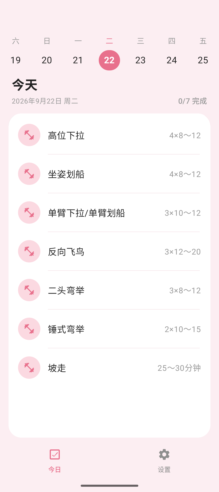
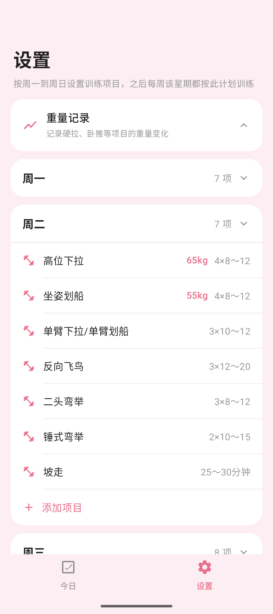
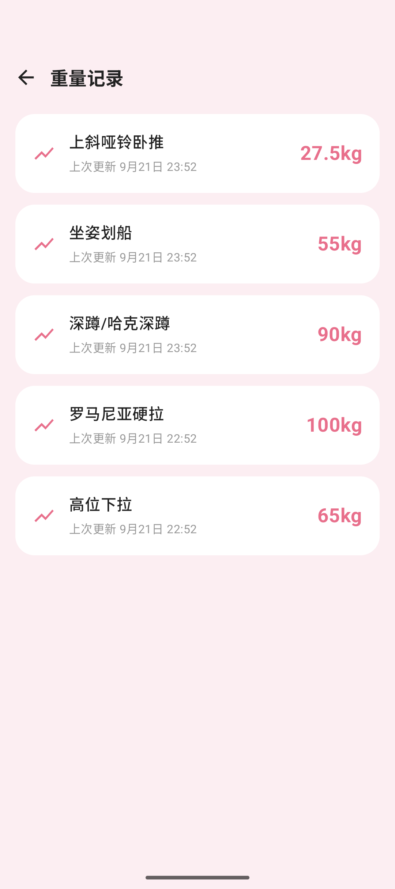

# 每日健身 Daily Fitness

一个简洁的 Android 每日健身计划与重量记录 App，粉色主题，使用 Jetpack Compose 构建，纯本地存储。

## 功能

### 今日训练

- 顶部日期条默认把今天放在正中间，可左右滑动或点击查看任意日期的训练计划，并显示当天完成进度
- **逐组滑动打卡**：右滑项目逐组累计完成（多组项目需集齐设定组数），全部集齐时有金色印章与粒子动效；左滑撤回一组
- 没有计划的日期显示休息状态

### 计划设置

两种计划模式可自由切换，按周模板完整保留：

- **按周分配**：按周一到周日设置训练项目，设置一次后以后每周的该星期都自动套用这套计划
- **循环计划（不看周几）**：按「训练日 / 休息日」序列逐日循环，适合连三休一、轮班等不固定周几的作息
  - 三分化：练 3 休 1（A推 B腿 C拉 休息）或练 6 休 1（两轮一休，A/B 两套内容）
  - 二分化：练 2 休 1 或练 4 休 1（A上肢 B下肢）
  - 自定义编排：自由增删训练日与休息日、新增训练日类型，拼出任意节奏
  - 循环起点可重置，也可点击序列中的任意节点把该日对齐到今天；日期条同步显示 A/B/C/休
- **拖拽排序**：长按某条项目，在当天内上下拖动即可调整训练顺序，粉色指示线标注插入位置
- **跨天复制**：把项目直接拖到其他天的卡片上（卡片高亮提示），松手即复制到该天计划，原天项目保留
- **一键清空整天**：每天卡片标题栏右侧提供清空按钮，二次确认后删除该天全部项目（重量历史保留）
- **自定义项目**：自由填写项目名称、组数、次数 / 时长，支持次数范围（如 `4×6～10`）、分钟、步数、纯组数等写法

### 重量记录

- 为硬拉、卧推等项目记录训练重量，调整重量时自动记录时间
- 折线图展示重量增长过程，支持手动补记与删除单条记录

### 其他

- 纯本地存储：SharedPreferences + JSON，无需联网，无账号

## 界面预览

| 今日训练 | 计划设置 | 重量记录 |
| :---: | :---: | :---: |
|  |  |  |

## 技术栈

- Kotlin、Jetpack Compose、Material 3
- 单 Activity 架构，数据层为 SharedPreferences 序列化仓库
- minSdk 24 / targetSdk 37

## 构建

用 Android Studio 打开本目录，Gradle 同步后直接 Run；或使用命令行：

```bash
# Windows
gradlew.bat assembleDebug
# macOS / Linux
./gradlew assembleDebug
```

Debug 产物位于 `app/build/outputs/apk/debug/app-debug.apk`。

### Release 构建

Release 包使用项目根目录下的签名配置（`keystore.properties` 与 `*.jks` 已在 `.gitignore` 中忽略）：

```properties
storeFile=gym-release.jks
storePassword=你的库口令
keyAlias=gym
keyPassword=你的密钥口令
```

配置好后执行：

```bash
gradlew.bat assembleRelease     # Windows
./gradlew assembleRelease       # macOS / Linux
```

Release 产物位于 `app/build/outputs/apk/release/app-release.apk`。

### 回归验证

UI 回归测试会重置测试数据，必须使用独立的 `.verification` 包名运行：

```powershell
.\gradlew.bat -I verification.init.gradle :app:connectedDebugAndroidTest
```

该配置只影响 debug 测试包，正式版包名和数据不变。UI 测试也会检查包名，阻止在正式包名下清空数据。

## 下载

可在 [Releases](../../releases) 页面下载预编译 APK，最新版本为 [v1.7.1](../../releases/tag/v1.7.1)（2026-10-23 发布）。

- [下载 `daily-fitness-v1.7.1-release.apk`](https://github.com/sanda-tt/daily-fitness/releases/download/v1.7.1/daily-fitness-v1.7.1-release.apk)：正式签名的 release 安装包，支持 Android 7.0 及以上。

### v1.7.1 修复

- 升级保留自定义计划、项目 ID、重量历史和打卡记录，避免旧项目 ID 被复用。
- 二分化与三分化分别保存训练内容，切换及重启后保留各自编辑结果；重量记录仍共享。
- 自定义训练日类型新增后即可编辑、加入序列，空类型不再被重复分配。
- 已清空的训练日保持为空，切换预设不会自动重新填入默认项目。

### v1.4–v1.7 关键变化

- **v1.4**：内置 Push / Pull / Legs A/B 一周双循环分化计划，包含游泳日；支持内置计划版本自动迁移，更新模板时保留重量历史与打卡记录。
- **v1.5**：新增每日训练主题，今日页显示主题徽章，设置页可编辑并自动保存，折叠卡片也能查看主题。
- **v1.6**：更换白底粉色 MR 启动器图标，包含方形、圆形与自适应图标；仅更新图标，功能与 v1.5 一致。
- **v1.7**：新增「循环计划」模式，不看周几、按序列循环——三分化练 3 休 1 / 练 6 休 1、二分化练 2 休 1 / 练 4 休 1，并支持自定义编排；日期条同步显示 A/B/C/休，可点击节点对齐到今天，按周计划与全部原有功能完整保留。

### 覆盖安装说明

- 已安装 v1.3 起的同签名正式 release 版，可直接安装 v1.7.1 覆盖升级，保留训练计划、重量历史与打卡记录。升级无需卸载或清除数据。此前版本已被覆盖或删除的数据无法由本次升级恢复。
- 若已安装此前的 debug 版（如 v1.1 / v1.2）或其他不同签名版本，无法直接覆盖，需先卸载再安装。**卸载会清除本地训练计划、打卡记录与重量历史，请先自行保存需要的数据。**

## License

[MIT](LICENSE)
